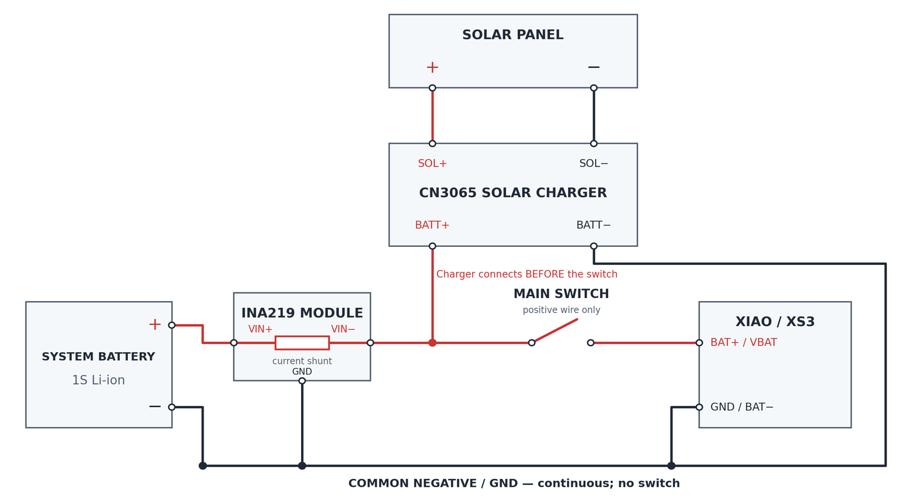

# Turtle Power System

The Hope Turtle uses **two separate battery systems**:

1. A **1S system battery** for TurtleShell, the XIAO ESP32-S3, sensors, GPS, display, telemetry and other electronics.
2. A dedicated **2S servo battery pack** for the MG996R sail servo.

This is a major upgrade from the earlier architecture, where one 3.7V battery powered both the electronics and the servo. Separating the two power domains keeps servo current spikes and electrical noise away from the XIAO and sensor buses.

---

## System Power



The TurtleShell electronics run from a single **21700 Li-ion cell** (1S, about 3.7 V nominal, 4200 mAh). The XIAO ESP32-S3 takes it directly on its underside **BAT+ / BAT− pads**, with no boost to 5 V.

Reading the chart from left to right:

1. **Battery + → INA219 VIN+.** Battery + connects only to the INA219. Nothing else touches the battery side of the shunt.
2. **INA219 VIN− is the system's positive node.** Both the solar charger and the main switch connect here.
3. **The CN3065 joins before the switch.** Solar keeps charging the battery while the electronics are switched off.
4. **The main switch is in the positive wire only** and feeds XIAO BAT+.
5. **One common negative, never switched.** Battery −, INA219 GND, CN3065 BATT− and XIAO BAT− all tie together. The INA219 needs its GND on this line, because it measures bus voltage from VIN− to GND.

USB-C can still power the XIAO with the main switch off.

---

## INA219 Battery Monitoring

Every amp going into or out of the battery passes through the INA219's shunt, so turtleOS sees **net battery current**: what the solar charger puts in, minus what the system draws.

| Current flow | Direction through the shunt | INA219 reading |
|---|---|---|
| Battery powering the system | VIN+ → VIN− | **positive** (discharging) |
| Solar or USB charging the battery | VIN− → VIN+ | **negative** (charging) |

Example: solar supplies 300 mA and the system draws 120 mA. The extra 180 mA flows into the battery, and the INA219 reads **−180 mA**.

turtleOS keeps this sign everywhere: telemetry `ina_current_ma` and the Wrangler Power characteristic both send the raw reading.

**Two charge paths.** Solar charge comes in through the CN3065. With USB-C plugged in **and the main switch on**, the XIAO's own charger also charges the battery, back through the switch and the shunt. Both read as negative current, so a charging reading with no sun usually means USB.

**Battery voltage.** The INA219 measures voltage at VIN−, on the far side of the shunt and battery leads from the cell, so the reading drops slightly under load and rises while charging. turtleOS removes that I×R swing with the `battery_r_ohm` config key (see `CLAUDE.md` for calibration). Every battery voltage and SoC it shows or reports is the corrected value.

The INA219 is on the onboard **I2C_SYS** bus at 0x40.

---

## Solar Charging

The Voltaic P126 panel (about 2 W) feeds the CN3065 solar charger, whose BATT+ output joins INA219 VIN− as shown in the chart.

**The panel and charger don't match yet.** The Robotistan **CN3065 Mini Solar Li-Po Charger** accepts about **4.4–6 V**. The P126 runs above 6 V, and its open-circuit voltage is higher still. Before deployment, do one of these:

- use a solar charger rated for the P126's full voltage range,
- add input regulation or clamping ahead of the CN3065,
- or use a lower-voltage panel the CN3065 can take.

---

## Servo Power

The MG996R servo now uses its own dedicated **2S battery pack** made from two 3.7V 2000mAh 18650 cells in series.

```text
2 × 3.7V 2000mAh cells in series
        │
        ▼
7.4V nominal / 8.4V fully charged
2000mAh pack capacity
        │
        ▼
LM2596 buck regulator
        │
        ▼
~6V servo supply
        │
        ▼
MG996R
```

Because the cells are in series, the voltage doubles but the amp-hour capacity remains **2000mAh**.

The LM2596 steps the 2S pack down to the servo supply voltage. The regulator should be adjusted with a multimeter before connecting the servo; approximately **6.0V** is the current target.

The XIAO supplies only the servo PWM control signal:

| Servo wire | Connection |
|---|---|
| Red | LM2596 regulated output + |
| Brown / black | Servo power ground |
| Yellow / orange | XIAO servo PWM GPIO |

The servo must **not** be powered from the XIAO 3V3, 5V, BAT+ pad, or the main 1S system battery.

A Pololu isolated solid-state relay in the pack's + lead, controlled from XIAO GPIO40, lets turtleOS cut the LM2596 off while the servo is idle. See [adding_servo_switch.md](adding_servo_switch.md).

---

## Grounding Between Power Domains

The system and servo positive rails remain separate, but the XIAO and servo need a common reference for the PWM signal.

```text
XIAO PWM ─────────────────> Servo signal
XIAO GND ─────────────────> Servo regulator / servo GND

1S system battery +   ≠   2S servo battery +
```

This gives the servo and XIAO a shared signal ground without routing servo operating current through TurtleShell.

---

## Servo Battery Charging

For initial deployments, the 2S servo pack will be **fully charged before launch** and sized to last the planned voyage.

An onboard **2S balance charger / BMS** may be added later as an optional upgrade. Any charger used must support:

- 2S Li-ion chemistry
- 8.4V full-charge voltage
- cell balancing
- over-charge protection
- over-discharge protection

A 1S charger such as the CN3065 must never be used to charge the 2S servo pack.

---

## Power Domain Summary

| Domain | Battery | Regulation / Charging | Loads |
|---|---|---|---|
| System | 1 × 21700, 3.7V / 4200mAh | Solar charger + XIAO USB charging | XIAO, TurtleShell, sensors, GPS, OLED, telemetry |
| Servo | 2 × 18650, 2S, 7.4V / 2000mAh | LM2596 buck to ~6V | MG996R servo |

The design deliberately separates **energy for computation** from **energy for movement**. The system battery keeps TurtleOS alive and can be replenished from solar energy, while the independent 2S pack absorbs the servo's high-current demands without destabilizing the navigation electronics.
